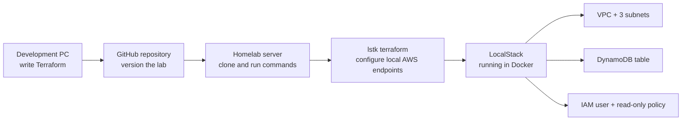

# Homelab Terraform Lab

I am learning Terraform and DevOps by deploying an AWS-style infrastructure lab to LocalStack on a separate amd64 homelab server. I write and review the configuration on my PC, store it in GitHub, then run Terraform against LocalStack on the server. The application is outside the scope of this first lab.

## How the lab fits together



Terraform currently defines the following resources in `us-east-2`:

| Resource | Name | Purpose |
| --- | --- | --- |
| VPC | `app1-vpc` | A `10.0.0.0/20` private network |
| Subnets | `app1-subnet-1`, `app1-subnet-2`, `app1-subnet-3` | Three `/22` networks in different Availability Zones |
| DynamoDB table | `app1-dynamodb` | A small on-demand table for task data |
| IAM user | `devsuperuser` | An identity with the AWS-managed `ReadOnlyAccess` policy |

The subnet ranges are `10.0.0.0/22`, `10.0.4.0/22`, and `10.0.8.0/22`. These are private lab addresses, not the server's public IP.

## Prerequisites on the homelab server

- An amd64 machine with [Docker](https://docs.docker.com/engine/install/) running.
- [Terraform CLI](https://developer.hashicorp.com/terraform/install).
- [LocalStack `lstk` CLI](https://docs.localstack.cloud/aws/developer-tools/running-localstack/lstk/).
- Git to clone this repository.

Follow the installation instructions for the server's operating system in those links. Confirm the tools are available with `docker --version`, `terraform version`, and `lstk --version`. The exact server installation commands will be documented after they have been verified on that machine.

## Manual LocalStack deployment

Start LocalStack on the server, then run the Terraform commands from the cloned repository:

```sh
lstk start
lstk terraform init
terraform fmt -check
lstk terraform validate
lstk terraform plan
lstk terraform apply
```

Review the plan before accepting the apply. [`lstk terraform`](https://docs.localstack.cloud/aws/connecting/infrastructure-as-code/terraform/) points the AWS provider at LocalStack. Use it for `plan`, `apply`, and `destroy` in this lab so those commands target the local emulator.

Check the resources after applying:

```sh
lstk aws ec2 describe-vpcs
lstk aws ec2 describe-subnets
lstk aws dynamodb describe-table --table-name app1-dynamodb
lstk aws iam get-user --user-name devsuperuser
lstk aws iam list-attached-user-policies --user-name devsuperuser
```

When finished, remove the Terraform-managed resources:

```sh
lstk terraform destroy
```

Terraform state and local configuration files are excluded by `.gitignore`. Do not commit credentials, LocalStack auth tokens, state files, or server addresses.

## Next steps

After the manual deployment and cleanup work reliably on the server, I plan to automate the same workflow with GitHub Actions.
