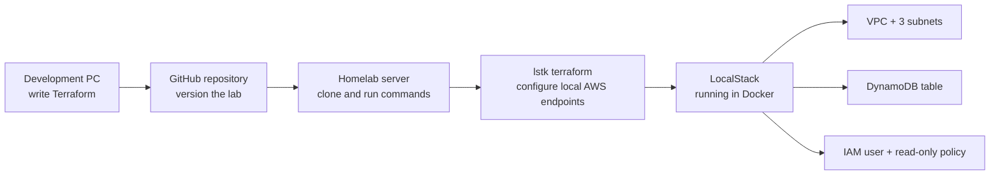

# Homelab Terraform Lab

I am learning Terraform and DevOps by deploying an AWS-style infrastructure lab to
LocalStack on a separate Ubuntu amd64 homelab server. I write and review the
configuration on my PC, store it in GitHub, then run Terraform against LocalStack on the
server. The application is outside the scope of this first lab.
I am using AI but in a co development role to bring me to the documentation
and help me learn what and why certain variables are needed see comments on the main.tf

## How the lab fits together



Terraform currently defines the following resources in `us-east-2`:

| Resource | Name | Purpose |
| --- | --- | --- |
| VPC | `app1-vpc` | A `10.0.0.0/20` private network |
| Subnets | `app1-subnet-1`, `app1-subnet-2`, `app1-subnet-3` | Three `/22` networks in different Availability Zones |
| DynamoDB table | `app1-dynamodb` | A small on-demand table for task data |
| IAM user | `devsuperuser` | An identity with the AWS-managed `ReadOnlyAccess` policy |

The subnet ranges are `10.0.0.0/22`, `10.0.4.0/22`, and `10.0.8.0/22`. These are private lab addresses, not the server's public IP.

## Prerequisites on the homelab server

- An Ubuntu amd64 machine with [Docker](https://docs.docker.com/engine/install/ubuntu/) running.
- [Terraform CLI](https://developer.hashicorp.com/terraform/install).
- [LocalStack `lstk` CLI](https://docs.localstack.cloud/aws/developer-tools/running-localstack/lstk/).
- [AWS CLI](https://docs.aws.amazon.com/cli/latest/userguide/getting-started-install.html) for the verification commands below.
- Git to clone this repository.
- [GitHub CLI (`gh`)](https://cli.github.com/manual/installation) to authenticate and clone this private repository.

### Install `lstk`

On my Ubuntu amd64 server, I installed `lstk` from LocalStack's pre-built binary release rather than through a package manager. To repeat that setup, follow the [official installation instructions](https://docs.localstack.cloud/aws/developer-tools/running-localstack/lstk/#installation): open the [release downloads](https://github.com/localstack/lstk/releases), select the archive named `lstk_<version>_linux_amd64.tar.gz`, extract it, and place the `lstk` executable in a directory on your `PATH`.

Verify the installation with `lstk --version`. LocalStack also requires Docker and a LocalStack account/license; see the [official prerequisites](https://docs.localstack.cloud/aws/developer-tools/running-localstack/lstk/#prerequisites). Confirm the other tools with `docker --version` and `terraform version`.

### Check Docker access

Docker must be running before `lstk start`. Check whether the current user can reach the Docker daemon:

```sh
docker info
```

If that reports permission denied for `/var/run/docker.sock`, run `sudo docker info`. If the command works with `sudo`, the daemon is running and the user needs socket access. On this single-user lab server, add the user to the `docker` group, disconnect the SSH session, and reconnect:

```sh
sudo docker info
sudo usermod -aG docker "$USER"
```

After reconnecting, `docker info` should work **without** `sudo` before running `lstk start`. Docker documents this in its [Linux post-installation guide](https://docs.docker.com/engine/install/linux-postinstall/). Membership in the `docker` group grants root-level control of the host.

If access is still denied after reconnecting, run `id -nG`; the current shell may not yet list `docker`.
Run `newgrp docker`, then retry `docker info` and `lstk start` in that same shell.

## Get the repository on the server

If the repository is private, authenticate with GitHub before cloning it. A headless server does not need a browser. Run `gh auth login` in its terminal, choose **Login with a web browser**, then open the URL shown by `gh` on another device. Enter the one-time code shown in the server terminal and complete the authorization in that device's browser. See the [GitHub CLI authentication guide](https://cli.github.com/manual/gh_auth_login).

```sh
gh auth login --hostname github.com --git-protocol https
gh api user --jq .login
gh repo clone OWNER/REPO
cd REPO
```

Replace `OWNER/REPO` and `REPO` with the repository's owner and name. The account check prints the signed-in GitHub username. For an interactive, one-time clone, use the browser flow; a manually created personal access token is unnecessary. Never copy a one-time code, token, or credential into this README or a commit.

## Manual LocalStack deployment

Start LocalStack on the server, then run the Terraform commands from the cloned repository:

```sh
lstk start
lstk terraform --region us-east-2 init
terraform fmt -check
lstk terraform --region us-east-2 validate
lstk terraform --region us-east-2 plan
lstk terraform --region us-east-2 apply
```

Review the plan before accepting the apply. [`lstk terraform`](https://docs.localstack.cloud/aws/connecting/infrastructure-as-code/terraform/) points the AWS provider at LocalStack. Its default region is `us-east-1`, so specify `--region us-east-2` before each Terraform action to match this lab's ticket. Use the same region for `plan`, `apply`, and `destroy`.

Check the resources after applying:

```sh
lstk aws ec2 describe-vpcs --region us-east-2 --filters Name=tag:Name,Values=app1-vpc
lstk aws ec2 describe-subnets --region us-east-2 --filters Name=tag:Name,Values=app1-subnet-1,app1-subnet-2,app1-subnet-3 --query 'Subnets[].{Name:Tags[0].Value,CIDR:CidrBlock,AZ:AvailabilityZone,Available:AvailableIpAddressCount}' --output table
lstk aws dynamodb describe-table --region us-east-2 --table-name app1-dynamodb --query 'Table.{Name:TableName,ARN:TableArn,Status:TableStatus,Billing:BillingModeSummary.BillingMode}'
lstk aws iam get-user --region us-east-2 --user-name devsuperuser --query 'User.UserName'
lstk aws iam list-attached-user-policies --region us-east-2 --user-name devsuperuser --query 'AttachedPolicies[].PolicyName'
```

The subnet table should show `10.0.0.0/22`, `10.0.4.0/22`, and `10.0.8.0/22` in `us-east-2a`, `us-east-2b`, and `us-east-2c`, with 1,019 available addresses each. The DynamoDB summary should show `app1-dynamodb` as `ACTIVE` with `PAY_PER_REQUEST` billing and a `us-east-2` ARN. The IAM policy list should show `ReadOnlyAccess`.

When finished, remove the Terraform-managed resources:

```sh
lstk terraform --region us-east-2 destroy
```

If an earlier run used the default `us-east-1` region, destroy that run with `lstk terraform --region us-east-1 destroy` before deploying again in `us-east-2`.

Terraform state and local configuration files are excluded by `.gitignore`. Do not commit credentials, LocalStack auth tokens, state files, or server addresses.

## Results from a manual run

I applied this configuration to LocalStack in `us-east-2` and checked the resources with `lstk aws`:

| Check | Observed result |
| --- | --- |
| VPC | `app1-vpc` was available with CIDR `10.0.0.0/20` |
| Subnet 1 | `10.0.0.0/22` in `us-east-2a`; 1,019 available addresses |
| Subnet 2 | `10.0.4.0/22` in `us-east-2b`; 1,019 available addresses |
| Subnet 3 | `10.0.8.0/22` in `us-east-2c`; 1,019 available addresses |
| DynamoDB | `app1-dynamodb` was `ACTIVE` with `PAY_PER_REQUEST` billing in `us-east-2` |
| IAM | `devsuperuser` had the AWS-managed `ReadOnlyAccess` policy attached |

I then ran `lstk terraform --region us-east-2 destroy` to clean up the Terraform-managed resources. Generated resource IDs, account IDs, and server details are omitted from this record.

## Next steps

After the manual deployment and cleanup work reliably on the server, I plan to automate the same workflow with GitHub Actions.
